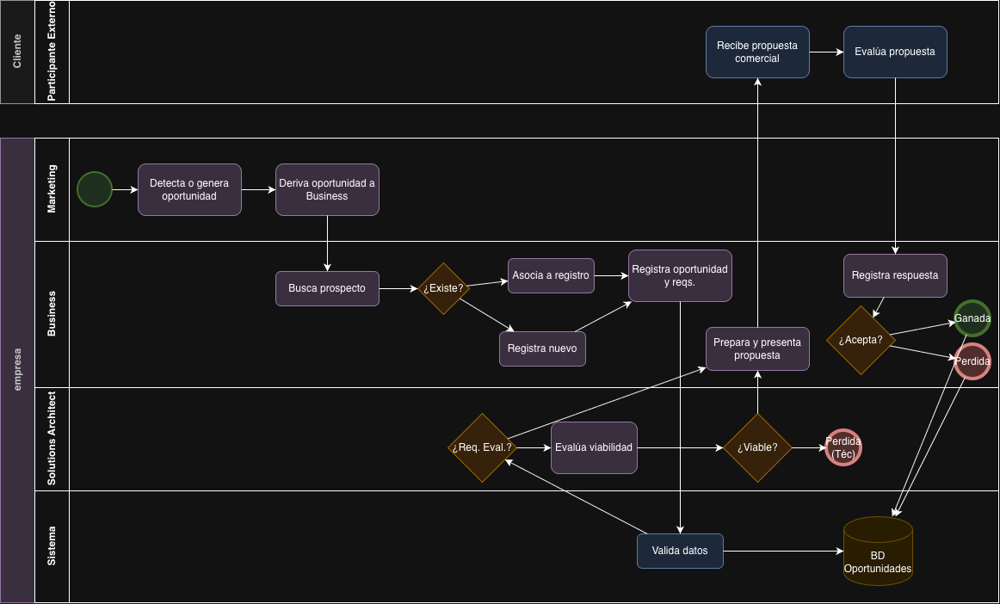
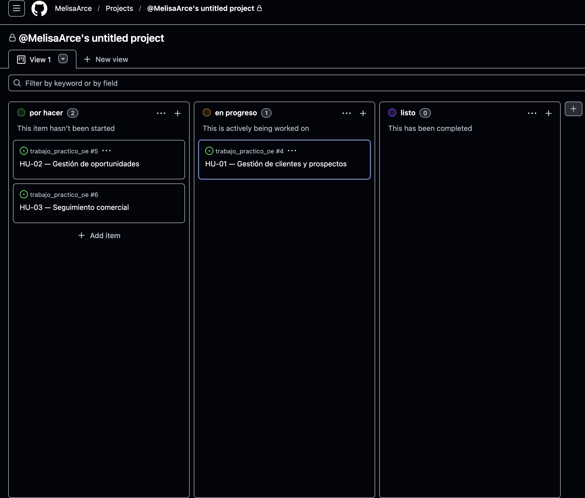
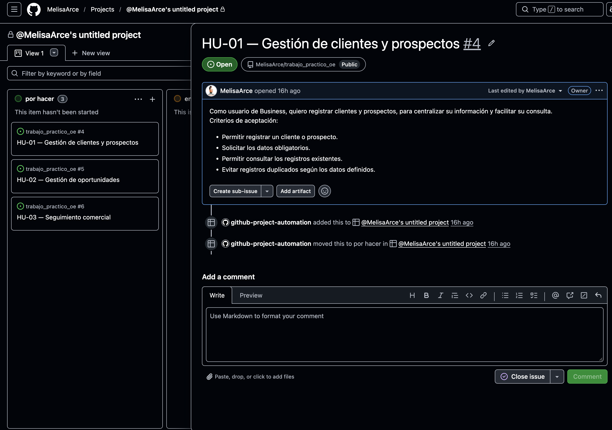

# Módulo de Gestión de Oportunidades Comerciales

**Organización:** Empresa de consultoría tecnológica especializada en soluciones cloud.

## Descripción del proyecto
El presente proyecto propone el diseño de un Módulo de Gestión de Oportunidades Comerciales para una consultora tecnológica especializada en soluciones cloud. 

La propuesta surge de la necesidad de fortalecer la generación y diversificación de oportunidades comerciales, centralizando la información de clientes actuales y potenciales y facilitando el seguimiento de las oportunidades desde su identificación hasta su cierre.

## Problemática
La gestión de oportunidades comerciales requiere organizar información proveniente de distintas fuentes y mantener un seguimiento de los contactos, requerimientos, propuestas y resultados.

La falta de centralización puede dificultar la consulta de antecedentes, la continuidad de las gestiones comerciales y el análisis de los resultados obtenidos.

## Objetivo general
Diseñar un módulo que permita centralizar y organizar la información comercial de la empresa, facilitando el registro de clientes y prospectos, la gestión de oportunidades y el seguimiento de su evolución.

## Alcance del módulo
Se contemplan las siguientes funcionalidades:
- Registro y consulta de clientes y prospectos.
- Registro de oportunidades comerciales y su origen.
- Asociación de oportunidades con clientes o prospectos.
- Registro de requerimientos iniciales.
- Seguimiento de las oportunidades mediante un pipeline comercial.
- Registro de interacciones y próximas acciones.
- Registro de oportunidades ganadas o perdidas y sus respectivos motivos.
- Consulta de indicadores comerciales para facilitar el análisis y la toma de decisiones.

*Nota: El módulo busca mejorar la organización y trazabilidad de la información comercial. No garantiza por sí mismo la captación de nuevos clientes ni la concreción de oportunidades.*

## Proceso de negocio
El proceso modelado contempla la identificación de oportunidades, su registro y evaluación, la preparación de propuestas comerciales, el seguimiento de las respuestas y el cierre de cada oportunidad.

**Diagrama BPMN:**

## 👤 Historias de usuario

### HU-01 — Gestión de clientes y prospectos
> **Como** usuario de Business, **quiero** registrar clientes y prospectos, **para** centralizar su información y facilitar su consulta.

**Criterios de aceptación:**
- Permitir registrar un cliente o prospecto.
- Solicitar los datos obligatorios.
- Permitir consultar los registros existentes.
- Evitar registros duplicados según los datos definidos.

### HU-02 — Gestión de oportunidades comerciales
> **Como** usuario de Business, **quiero** registrar y actualizar oportunidades comerciales asociadas a clientes o prospectos, **para** realizar seguimiento de su estado dentro del pipeline.

**Criterios de aceptación:**
- Permitir crear una oportunidad asociada a un cliente o prospecto.
- Registrar origen y requerimientos iniciales.
- Permitir actualizar el estado de la oportunidad.
- Registrar el resultado de la oportunidad: ganada o perdida.

### HU-03 — Seguimiento comercial
> **Como** usuario de Business, **quiero** registrar interacciones y próximas acciones relacionadas con una oportunidad, **para** mantener su historial actualizado y evitar la pérdida de información.

**Criterios de aceptación:**
- Permitir registrar interacciones relacionadas con una oportunidad.
- Guardar fecha y descripción del seguimiento.
- Permitir indicar una próxima acción.
- Consultar el historial de seguimientos.

## Gestión del proyecto
El seguimiento de las actividades se realiza mediante GitHub Projects, utilizando los estados: `Por Hacer`, `En Progreso` y `Listo`.

**Evidencia del tablero ágil:**

## Indicadores de control
Se definieron indicadores para evaluar la calidad de los datos y el rendimiento esperado del módulo:
- Integridad de los datos registrados.
- Asociación de oportunidades con clientes o prospectos.
- Trazabilidad de los seguimientos comerciales.
- Disponibilidad del sistema (Uptime).
- Latencia de consultas.

> Los estándares y mecanismos de medición técnica y funcional se encuentran documentados en [Indicadores de control](docs/indicadores.md).

## Control de versiones
El proyecto utiliza Git y GitHub para administrar los cambios y mantener un historial de las modificaciones realizadas. Se contempla el trabajo mediante ramas secundarias y la integración de cambios a través de Pull Requests.

## Declaración de uso de Inteligencia Artificial
Durante la elaboración del trabajo se utilizaron herramientas de Inteligencia Artificial Generativa (Gemini / ChatGPT) como apoyo para el análisis, la estructuración de la sintaxis en Markdown, la formulación del modelo BPMN y la revisión de estilo. Las propuestas generadas fueron revisadas críticamente y adaptadas de acuerdo con los objetivos y el alcance del proyecto. Las decisiones finales, la fundamentación teórica y la responsabilidad total sobre el contenido corresponden a la alumna autora.

## Entregas anteriores
La documentación correspondiente a las primeras fases del proyecto (donde se detalla el análisis sistémico de la organización) se encuentra alojada en el siguiente enlace:
- [🔗 Acceder a entregas previas en Google Drive](https://drive.google.com/drive/folders/1XS57-1oA1lEXHaETnVWZahySTHegut2P?usp=sharing)

## Autora
- **Melisa Arce**

## Referencias
- Documentación y entregas anteriores del proyecto de Organización Empresarial.
- Material de estudio de la asignatura Organización Empresarial (UTN).
- Documentación de GitHub Projects: [Planning and tracking with Projects](https://docs.github.com/en/issues/planning-and-tracking-with-projects)